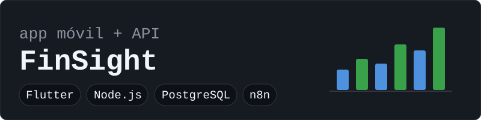
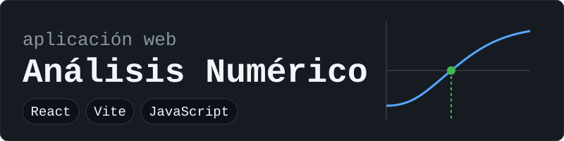
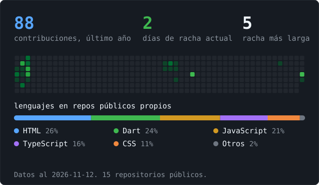

 

 

Me gusta convertir ideas en software que funciona de punta a punta. Mi foco es el **backend**: diseñar APIs, modelar bases de datos y dejar los servicios listos para que una app web o móvil los consuma. También trabajo en frontend y desarrollo móvil, y me interesa automatizar procesos y aplicar inteligencia artificial dentro de los sistemas de software.

> [!IMPORTANT]
> **Busco prácticas profesionales para el periodo 2027-I.** Cursando noveno semestre de Ingeniería de Sistemas en la Universidad Simón Bolívar, Cúcuta, Colombia. Mi enfoque es Backend y Full Stack.

 

| Área | Tecnologías |
|:--|:--|
| **Backend** | `Java` `Spring Boot` `Node.js` `Express` `Python` `Django` |
| **Frontend y móvil** | `React` `JavaScript` `TypeScript` `Flutter` `HTML5` `CSS3` |
| **Bases de datos** | `PostgreSQL` `MySQL` |
| **Herramientas** | `Git` `GitHub` `Docker` `Linux` `Postman` |
| **Automatización** | `n8n` |

 

Aplicación de finanzas personales para registrar ingresos y gastos, definir metas de ahorro y presupuestos, y revisar el análisis de los movimientos. Tiene tres piezas:

- **App móvil en Flutter.** Inicio de sesión con opción biométrica, movimientos, metas de ahorro, presupuestos y gráficas de análisis. [Ver repositorio del frontend](https://github.com/Jhoansbr/FinSight)
- **API en Node.js.** Express, Prisma y PostgreSQL, con autenticación JWT, documentación Swagger, pruebas con Jest y despliegue con Docker. [Ver repositorio del backend](https://github.com/Jhoansbr/finsight-back)
- **Automatización con n8n e IA.** Un flujo diario que analiza las transacciones con un modelo de OpenAI y un bot de Telegram que interpreta mensajes en lenguaje natural para registrar gastos.

En desarrollo: predicciones y generación de reportes en el backend.

 

Aplicación web para resolver problemas de análisis numérico, con tabla de iteraciones, gráficas interactivas, fórmulas renderizadas y teoría de cada método. Incluye bisección, Newton-Raphson, secante, punto fijo, interpolación de Lagrange y Simpson 3/8. [Ver repositorio](https://github.com/Jhoansbr/Analisis-Numerico)

 

 

| Formación | Institución |
|:--|:--|
| Ingeniería de Sistemas | Universidad Simón Bolívar |
| Google Cybersecurity Certificate *(en curso)* | Google / Coursera |
| Programación intermedia | Talento Tech / MinTIC |
| Desarrollo con Django | Meta / Coursera |
| Formación en Python | MinTIC / Universidad Distrital |

 

Si tu equipo busca a alguien que quiera aprender y construir backend, o si tienes un proyecto tecnológico en mente, escríbeme y lo conversamos.

 

