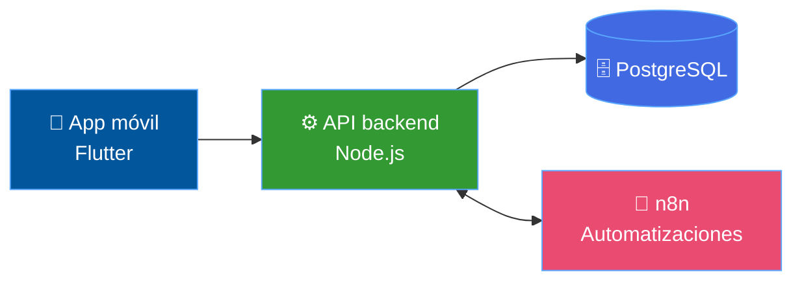
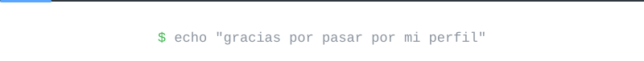

 

  

 

 

Me apasiona transformar ideas en soluciones de software. Disfruto el **desarrollo backend**, el **diseño de APIs**, la **gestión de bases de datos** y construir aplicaciones completas, de la base de datos a la pantalla.

> [!TIP]
> **Estoy buscando prácticas profesionales para 2027-I.** Cursando noveno semestre de Ingeniería de Sistemas en la Universidad Simón Bolívar, con enfoque en Backend y Full Stack.

<table>
<tr>
<td align="center" width="33%">
<h3>🧱</h3>
<b>Arquitectura de software</b> 
Aprendiendo a diseñar sistemas que escalan
</td>
<td align="center" width="33%">
<h3>🌐</h3>
<b>Desarrollo web</b> 
Del servidor al navegador
</td>
<td align="center" width="33%">
<h3>🔐</h3>
<b>Ciberseguridad</b> 
Google Cybersecurity Certificate, en curso
</td>
</tr>
</table>

<b>💬 Pregúntame sobre...</b>

 

- Diseño de APIs con **Node.js / Express** y **Spring**
- Modelado de bases de datos en **PostgreSQL** y **MySQL**
- Apps móviles con **Flutter**
- Automatizaciones con **n8n**
- Aplicaciones web con **React**, **Django** y **TypeScript**

 

 

**⚙️ Backend**

  

**🎨 Frontend y móvil**

  

**🗄️ Datos y herramientas**

  

**🤖 Automatización**

 

 

<table>
<tr>
<td width="50%" align="center" valign="top">

</td>
<td width="50%" align="center" valign="top">

</td>
</tr>
</table>

<b>🧩 Ver cómo encajan las piezas de FinSight</b>

 

 

 

 

 

| Programa | Institución |
|:--|:--|
| Google Cybersecurity Certificate *(en curso)* | Google / Coursera |
| Programación intermedia | Talento Tech, MinTIC |
| Desarrollo con Django | Meta / Coursera |
| Formación en Python | MinTIC / Universidad Distrital |

 

 

**¿Tienes un proyecto, una práctica o un reto técnico?** Escríbeme.

  

Construyendo, aprendiendo y mejorando una línea de código a la vez.

