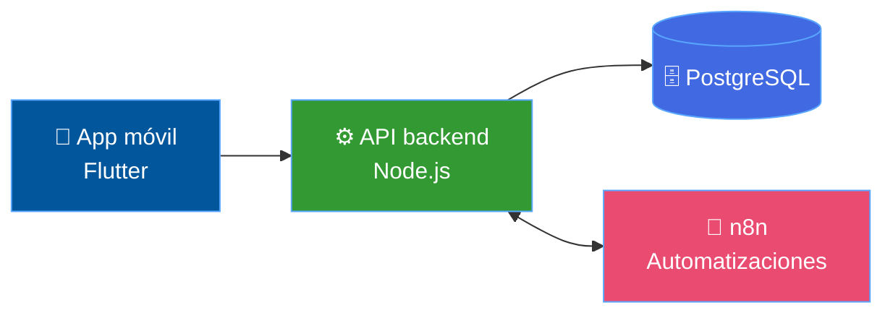

<div align="center">


<a href="https://github.com/Jhoansbr">

</a>

<br/>

<a href="https://linkedin.com/in/jhoanblanco2004"></a>
<a href="mailto:jhoansbr2004@gmail.com"></a>
<a href="https://github.com/Jhoansbr"></a>


</div>

<br/>

<div align="center">

</div>

<table>
<tr>
<td width="58%" valign="top">

Me apasiona transformar ideas en soluciones de software. Disfruto el **desarrollo backend**, el **diseño de APIs**, la **gestión de bases de datos** y construir aplicaciones completas, de la base de datos a la pantalla.

> [!TIP]
> **Estoy buscando prácticas profesionales para 2027-I.** Si tu equipo necesita a alguien con ganas de aprender y de construir, hablemos.

</td>
<td width="42%" valign="top">

```yaml
nombre: Jhoan Sebastián Blanco
estudio: Ingeniería de Sistemas
universidad: Universidad Simón Bolívar
semestre: Noveno
enfoque: Backend & Full Stack
objetivo: Prácticas | 2027-I
```

</td>
</tr>
</table>

<div align="center">


<sub>Lo que estoy fortaleciendo ahora mismo</sub>

</div>

<br/>

<div align="center">


<br/>

**⚙️ Backend**


<br/><br/>

**🎨 Frontend y móvil**


<br/><br/>

**🗄️ Datos y herramientas**


<br/><br/>

**🤖 Automatización**


</div>

<br/>

<div align="center">

</div>

<table>
<tr>
<td width="50%" valign="top">

<h3 align="center">💰 FinSight</h3>

<div align="center">


</div>

<br/>

Aplicación de gestión financiera personal que facilita el registro, organización y análisis de movimientos económicos.

- 📱 Aplicación móvil
- 🔌 API backend
- 🗄️ Base de datos PostgreSQL
- ⚡ Automatizaciones con n8n

<div align="center">

<a href="https://github.com/Jhoansbr/FinSight"></a>
<a href="https://github.com/Jhoansbr/finsight-back"></a>


</div>

</td>
<td width="50%" valign="top">

<h3 align="center">📐 Análisis Numérico</h3>

<div align="center">


</div>

<br/>

Aplicación web para resolver problemas matemáticos con distintos métodos numéricos.

- 📉 Método de bisección
- 📈 Interpolación de Lagrange
- 🎯 Newton-Raphson
- ✂️ Método de la secante

<div align="center">

<a href="https://github.com/Jhoansbr/Analisis-Numerico"></a>


</div>

</td>
</tr>
</table>

<details>
<summary><b>🧩 Ver cómo encajan las piezas de FinSight</b></summary>

<br/>



</details>

<br/>

<div align="center">


<br/>


</div>

<br/>

<div align="center">

</div>

| Programa | Institución |
|:--|:--|
| 🔐 Google Cybersecurity Certificate *(en curso)* | Google / Coursera |
| 💻 Programación intermedia | Talento Tech, MinTIC |
| 🌐 Desarrollo con Django | Meta / Coursera |
| 🐍 Formación en Python | MinTIC / Universidad Distrital |

<br/>

<div align="center">


**Prácticas profesionales, proyectos de desarrollo y nuevos retos técnicos.**

<a href="mailto:jhoansbr2004@gmail.com"></a>
<a href="https://linkedin.com/in/jhoanblanco2004"></a>

</div>


